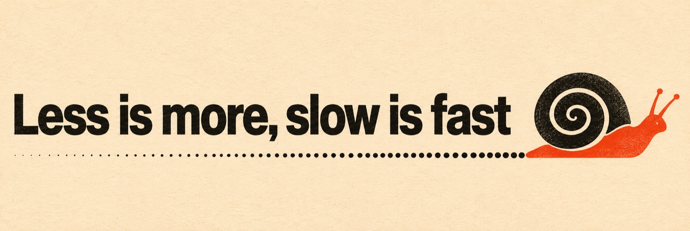
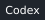
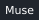
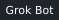
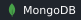
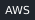
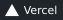

<table>
  <tr><td><strong>Hi, I'm Ribin</strong> <a href="https://www.caolibin.com/">Blog</a> · <a href="https://www.caolibin.com/playground/">Playground</a> · <a href="https://github.com/ribincao/strudel-dreamcore">Music</a></td></tr>
  <tr><td align="center">
    
    
     
    
  </td></tr>
  <tr><td><strong>Language</strong> 
    
    
  </td></tr>
  <tr><td><strong>Agents &amp; AI/SI</strong> 
    
    
    
    
  </td></tr>
  <tr><td><strong>Backend &amp; Data</strong> 
    
    
    
    
    
  </td></tr>
  <tr><td><strong>Infrastructure</strong> 
    
    
    
    
    
  </td></tr>
</table>
